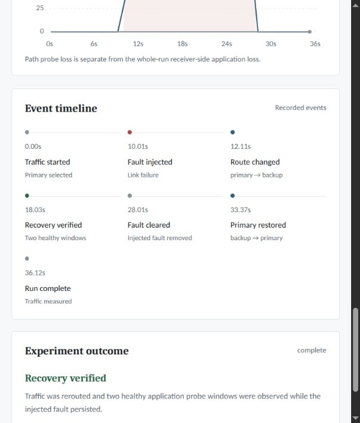
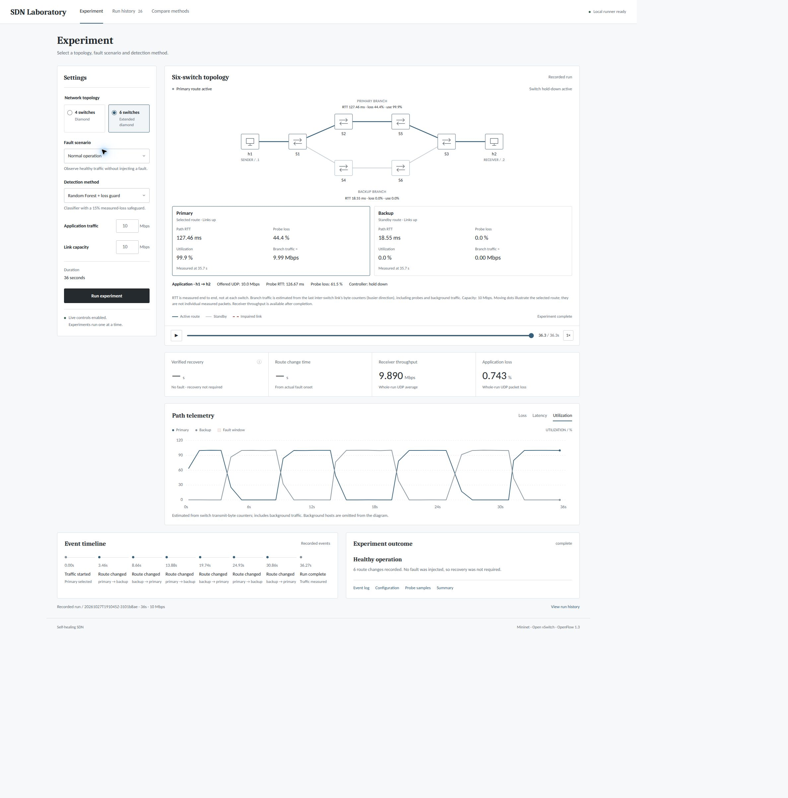

# AI Assisted Self Healing SDN

**BCSE308P Computer Networks Lab · Team 5 · Slot L13 + L14**  
Vaibhav Bakshi · 24BCE2052

This project detects path degradation in a Mininet network and moves application
traffic to a healthy backup path. A Python control loop measures packet loss,
round trip time, RTT variation and link utilization. Open vSwitch applies the
forwarding changes through OpenFlow 1.3. A local dashboard shows the topology,
measurements, event timeline, recorded playback and downloadable evidence.

The application supports four- and six-switch topologies, six fault scenarios,
three detection methods, configurable traffic and link capacity, and automatic
return to the primary path after stable recovery.

## Contents

- [Submission files](#submission-files)
- [Repository contents](#repository-contents)
- [Installation](#installation)
- [Execute the project](#execute-the-project)
- [View saved evidence](#view-saved-evidence)
- [Network and implementation](#network-and-implementation)
- [Testing results and evidence](#testing-results-and-evidence)
- [Automated checks](#automated-checks)
- [Dashboard screenshots](#dashboard-screenshots)
- [Troubleshooting](#troubleshooting)

## Submission files

The prefix `L13_L14_Team5` represents slot **L13 + L14**, Team **5**.

| VTOP assignment | File or submission |
| --- | --- |
| 8 — Project report | [L13_L14_Team5_Report.pdf](documents/L13_L14_Team5_Report.pdf) |
| 9 — Presentation | [L13_L14_Team5_PPT.pptx](documents/L13_L14_Team5_PPT.pptx) |
| 10 — Repository | [GitHub repository URL](https://github.com/Vaibhav1506/AI-Assisted-Self-Healing-SDN) |

**The certificate signature on report page 3 still needs to be supplied before
final VTOP report upload.** Update the PDF after completing the signature.

## Repository contents

```text
README.md                    Combined project documentation
main.py                      Application entry point
reset_dashboard.py           Clear or restore the dashboard history cutoff
requirements.txt             Exact package versions from the lab machine
src/selfheal/                Controller, topology, telemetry and experiments
src/selfheal/assets/         Required fitted detector.joblib model
dashboard/                   Local server and browser interface
documents/                   Report PDF and presentation
tests/                       Policy, accounting and configuration checks
tools/restore_evidence.py    Check and restore saved dashboard recordings
evidence/runs/report/        Eight runs used by the report and slides
evidence/runs/failback/      Three automatic-return demonstrations
evidence/runs/additional/    Separate 10 Mbps offered-load stress example
evidence/screenshots/        Original dashboard captures
evidence/verification/       Recorded checks and environment information
evidence/manifest.json      Byte counts and SHA-256 checksums for raw run files
evidence/results.csv        Aggregate metrics for all 12 recordings
```

The simulation is defined in `src/selfheal/network.py` and
`src/selfheal/topology.py`. This project uses Mininet; it has no Cisco Packet
Tracer `.pkt` file or database. The source, trained model, configuration defaults,
flow dumps and raw results needed to inspect the implementation are included.

## Installation

Run commands from the cloned repository directory. The project can be placed
in any directory; commands use repository-relative paths.

```bash
git clone https://github.com/Vaibhav1506/AI-Assisted-Self-Healing-SDN.git
cd AI-Assisted-Self-Healing-SDN
```

### Linux setup

The tested lab environment used Linux, Python 3.14.4, Mininet and Open vSwitch.
Live experiments need Linux network namespaces, Open vSwitch kernel support and
administrator access. Native Windows/macOS execution has not been verified;
a compatible Linux VM is an option.

For a Debian/Ubuntu-style system with these packages available:

```bash
sudo apt-get update
sudo apt-get install -y git python3 python3-venv python3-pip mininet \
  openvswitch-switch iperf3 iputils-ping iproute2
sudo systemctl start openvswitch-switch
```

Without systemd, use the system's service manager to start Open vSwitch.
Check that ovs-vsctl, ovs-ofctl, iperf3, ping, tc, ip, ss and mnexec are on PATH.

The dashboard uses Python's standard library and needs no Node.js, npm or
external web service.

### Python environment

`main.py` uses `.venv/bin/python` under the repository root. Create this
machine-specific environment after cloning; it is not included in GitHub.

```bash
python3 -m venv --system-site-packages .venv
.venv/bin/python -m pip install -r requirements.txt
python3 main.py doctor
```

`--system-site-packages` exposes the system Mininet module inside the environment.
`doctor` must report all required binaries/modules and `trained_detector: ready`.
It checks availability only, not a running network.

Recorded package versions: numpy 2.3.5, scipy 1.18.1, scikit-learn 1.9.1,
joblib 1.5.2 and threadpoolctl 3.7.0. These match the lab machine. A clean install
on a second machine has not been verified. If pip reports an unavailable version
or unsupported interpreter, use a compatible environment before changing pins.
The serialized scikit-learn model may not work with another library version.

The required model is `src/selfheal/assets/detector.joblib`. Its SHA-256 is:

```text
5f3528e6490b50c7fc7e2a33f1556533ac5ebc00356a85f99235ae4458983001
```

The loader checks its checksum and feature schema. Keep it with the source.

## Execute the project

```bash
sudo python3 dashboard/server.py
```

Open **http://127.0.0.1:8765** and keep the terminal open. Choose a scenario and
press **Run experiment**. Use six switches, 4 Mbps application traffic and
10 Mbps capacity for the report's network settings. A standard experiment
requests 36 seconds of traffic plus setup and cleanup. Experiments run
sequentially. The server binds only to this computer. Ctrl+C requests cleanup
of its own experiment.

The command line runs the same controller:

```bash
python3 main.py doctor
sudo python3 main.py smoke
sudo python3 main.py demo
python3 main.py show
```

`doctor` checks dependency/model availability. `smoke` runs a 22-second
threshold-based link-failure test and checks verified failover and automatic
return to primary. It does not evaluate the RF model. `demo` defaults to
guarded RF, six switches and packet loss. `show` prints the latest saved attempt.

```bash
sudo python3 main.py demo --scenario link_down
sudo python3 main.py demo --method rf_without_loss
sudo python3 main.py demo --method threshold --scenario delay
sudo python3 main.py demo --topology diamond
sudo python3 main.py demo --capacity 20 --load 4
sudo python3 main.py demo --no-failback
```

The retained identifier `rf_without_loss_guard` means **RF plus the measured-loss
guard**. `rf_without_loss` means RF alone. The dashboard uses readable labels.
See [Network and implementation](#network-and-implementation).

The dashboard controls select topology, scenario, method, traffic, capacity and
return policy. Scenarios are normal operation, link failure, packet loss,
congestion, increased delay and both paths down. Add `--port 8766` to the server
command if port 8765 is already in use.

## View saved evidence

```bash
python3 tools/restore_evidence.py
python3 reset_dashboard.py --restore
python3 dashboard/server.py
```

Open **Run history** in the local dashboard. This mode cannot start a new network.
The utility verifies file checksums, copies records to `.runtime/runs/`, skips
identical files and refuses to overwrite a different existing record. Originals
remain under `evidence/`. Use `--group report`, `--group failback` or
`--group additional` with the restore utility to select a single set. Refresh
the browser with Ctrl+Shift+R after clearing the dashboard display cutoff.

The report recordings predate automatic failback. To compare those packet-loss
methods, select **Stay on backup while healthy**, six switches, 4 Mbps load and
10 Mbps capacity. The comparison page uses the latest completed run with
matching settings, so check run IDs before quoting the report.

## Network and implementation

### Topology and configuration

`src/selfheal/network.py` defines hosts, IPs, the four-switch diamond, links,
switch ports, forwarding rules and faults. `src/selfheal/topology.py` extends
both branches for six switches. `src/selfheal/config.py` contains defaults and
validation. The Mininet simulation is built from Python; it has no Packet
Tracer file or configuration database.

| Topology | Primary branch | Backup branch |
| --- | --- | --- |
| Four switches (`diamond`) | h1 → cnS1 → cnS2 → cnS3 → h2 | h1 → cnS1 → cnS4 → cnS3 → h2 |
| Six switches (`long_diamond`) | h1 → cnS1 → cnS2 → cnS5 → cnS3 → h2 | h1 → cnS1 → cnS4 → cnS6 → cnS3 → h2 |

Application hosts: h1 (`10.77.0.1`), h2 (`10.77.0.2`). Background hosts b1/b2
provide primary-branch congestion traffic; b3/b4 support the backup branch.
The dashboard draws h1/h2 and switches. Probe destinations keep both paths
observable. Default inter-switch capacity is 10 Mbps, with 4 Mbps application
load. Congestion demand is 1.2 times selected capacity.

### Controller and detectors

`telemetry.py` measures paths; `core.py` applies recovery policy; `learning.py`
loads RF. Feature order: loss percentage, RTT, RTT variation, utilization.
`experiment.py` starts traffic, injects/clears faults, applies decisions and
writes raw evidence before producing the summary. The controller uses local
`ovs-ofctl` commands for OpenFlow 1.3 updates.

| CLI identifier | Dashboard label | Behavior |
| --- | --- | --- |
| `rf_without_loss_guard` | Random Forest + loss guard | RF plus an override for measured loss of at least 15% |
| `rf_without_loss` | Random Forest only | Same RF without the loss override |
| `threshold` | Fixed thresholds | Limits on loss, RTT, utilization and missing replies |

The first identifier is a retained name; the code explicitly enables the guard
for it. All methods share routing policy. Hard link failures have a separate
link-state check.

### Return to primary

After failover, default automatic failback requires five seconds of continuous
primary health and three consecutive healthy observations. Links must be up,
probe loss zero, RTT below 40 ms, utilization below 90%, and the detector must
approve. An unhealthy observation restarts the wait; hold-down also applies.
A hard failure of the active backup can bypass the wait if primary is healthy.

The event reason is `primary_restored`, shown as **Primary restored**.
`failover_changes` and `automatic_failbacks` are separate.
`fault_clear_to_failback_s` measures actual clearance to planned return.
Planned returns do not count as unnecessary reroutes.

Report/slide recordings predate failback and retain their numerical results.
Later evidence documents this extension separately in [Testing results and evidence](#testing-results-and-evidence).

### Interpretation and reproduction

Runs include metadata, probe CSV, timestamped events, receiver-side iperf data,
summary metrics and final OpenFlow dumps. Metadata records source/model hashes.
Historical records retain the fingerprint of their original code, which can
differ from the current source.

A route update is distinct from verified recovery: two healthy application
probe windows must follow rerouting while the fault persists. Whole-session
receiver UDP loss differs from per-path ping loss.

The detector is supplied for inference. Original fitting data/campaign tools
are absent, so this release does not reproduce training or independently
re-estimate validation accuracy. Results are single lab observations; scheduling
and NetEm loss are not deterministic even with the same experiment-group seed.

## Testing results and evidence

All values below come from the included raw recordings. The original report
uses eight single runs from 27 October 2026 at six switches, 4 Mbps application
load and 10 Mbps link capacity. The guarded loss run appears in both the scenario
results and method comparison, but counts once.

### Original report and presentation results

| Scenario | Method | Run ID | Receiver Mbps | UDP loss % | Verified recovery s |
| --- | --- | --- | ---: | ---: | ---: |
| Packet loss | RF + loss guard | [`20261027T150945Z-5b433df7`](evidence/runs/report/20261027T150945Z-5b433df7/summary.json) | 3.972 | 0.644 | 3.300 |
| Packet loss | RF only | [`20261027T151025Z-7bbacb9c`](evidence/runs/report/20261027T151025Z-7bbacb9c/summary.json) | 3.629 | 9.242 | Not observed |
| Packet loss | Fixed rules | [`20261027T151105Z-3f4808d8`](evidence/runs/report/20261027T151105Z-3f4808d8/summary.json) | 3.970 | 0.716 | 3.351 |
| Normal | RF + loss guard | [`20261027T151646Z-776f29cf`](evidence/runs/report/20261027T151646Z-776f29cf/summary.json) | 3.999 | 0.000 | Not required |
| Link failure | RF + loss guard | [`20261027T151725Z-f6caa845`](evidence/runs/report/20261027T151725Z-f6caa845/summary.json) | 3.764 | 5.864 | 8.022 |
| Congestion | RF + loss guard | [`20261027T151807Z-9c06ddef`](evidence/runs/report/20261027T151807Z-9c06ddef/summary.json) | 3.886 | 2.807 | 4.976 |
| Increased delay | RF + loss guard | [`20261027T151849Z-811520ad`](evidence/runs/report/20261027T151849Z-811520ad/summary.json) | 3.998 | 0.008 | 3.325 |
| Both paths down | RF + loss guard | [`20261027T151928Z-180225f4`](evidence/runs/report/20261027T151928Z-180225f4/summary.json) | 1.999 | 50.016 | No alternative |

These rows predate automatic failback. Use `--no-failback` for comparable new
experiments. A different timing on another run is not a failure by itself.
The RF-only loss result demonstrates a missed fault in this recording; it is
not an accuracy estimate or a general ranking.

### Later automatic-return examples

These 28 October 2026 runs use six switches, 4 Mbps load, 10 Mbps capacity and
enabled failback. They are additional evidence, not replacements for the report
tables. Their source hash matches the current controller files.

| Scenario | Run ID | Verified recovery s | Fault clearance to primary return s | Failovers | Automatic returns |
| --- | --- | ---: | ---: | ---: | ---: |
| Link failure | [`20261028T031343Z-9deb6c3e`](evidence/runs/failback/20261028T031343Z-9deb6c3e/summary.json) | 8.017 | 5.362 | 1 | 1 |
| Link failure | [`20261028T041720Z-9547e8cb`](evidence/runs/failback/20261028T041720Z-9547e8cb/summary.json) | 8.026 | 6.443 | 1 | 1 |
| Packet loss | [`20261028T041814Z-cf7bae53`](evidence/runs/failback/20261028T041814Z-cf7bae53/summary.json) | 3.217 | 6.364 | 1 | 1 |

The timeline screenshot corresponds to `20261028T031343Z-9deb6c3e`: it shows fault
onset, backup routing, verified application recovery, fault clearance and
`primary_restored`. The other two rows are later saved examples of the same
feature, not trials freshly rerun during submission packaging.

### Additional dashboard stress screenshot

`20261027T191045Z-3101b8ae` used 10 Mbps offered application load on 10 Mbps links
with no injected fault. Its screenshot records high utilization, transient probe
loss and several route changes. This is a separate stress example and is not
one of the report's 4 Mbps measurements. Do not use it as evidence of fault
recovery or as the report's normal-operation baseline.

### Evidence layout

- `evidence/runs/report/`: the exact eight records cited by the report and presentation.
- `evidence/runs/failback/`: three later records of automatic return to primary.
- `evidence/runs/additional/`: the separate 10 Mbps-load stress screenshot record.
- `evidence/screenshots/`: original dashboard captures; see [provenance below](#dashboard-screenshots).
- `evidence/verification/`: automated-check output and environment information.
- `evidence/manifest.json`: file sizes and SHA-256 checksums for every original run file.
- `evidence/results.csv`: aggregate metrics copied from the included summaries.

Raw run files are copied byte-for-byte from the lab machine. They retain original
absolute model paths, platform information and source hashes for provenance;
those paths are not needed to replay the recordings on another machine.

### Raw evidence format

| File | Meaning |
| --- | --- |
| `metadata.json` | Configuration, status, environment, timestamps and source/model hashes |
| `samples.csv` | Path observations and controller decisions during traffic |
| `events.jsonl` | Actual fault and route-change times |
| `application-iperf.json` | Raw application UDP transfer and receiver information |
| `summary.json` | Computed whole-run and recovery metrics |
| `cnS*-flows.txt` | Final per-switch OpenFlow entries |
| `*-server.json`, `background-iperf.json` | Supporting traffic-process output, where present |

[evidence/results.csv](evidence/results.csv) collects the same metrics for
all 12 selected runs. [manifest.json](evidence/manifest.json) records byte
counts and SHA-256 checksums for every original run file. CSV and raw JSON are
the numerical evidence; screenshots illustrate the interface.

Recovery requires two healthy application probe windows after rerouting while
the injected fault is active. Per-path ping loss is distinct from whole-run
receiver-side UDP loss. A route change alone is insufficient. Exact timing and
NetEm loss are variable, so these observations do not establish general
reliability, model accuracy or consistent superiority between methods.

## Automated checks

```bash
python3 -B -m unittest discover -s tests -v
```

These standard-library checks need neither root nor Mininet. They cover recovery
policy, stable failback, configuration propagation and metric accounting.

For a live rehearsal after installation:

```bash
sudo python3 main.py smoke
```

This builds a six-switch network, introduces a link failure, checks verified
recovery on backup, clears the fault and checks return to primary. It requests
22 seconds of traffic plus setup and cleanup. Success prints `SMOKE PASSED`.
It uses fixed thresholds and does not evaluate the RF model.

### Recorded verification

The recorded [unit-test output](evidence/verification/unit-tests.txt) reports
**18 passing tests**. They cover policy decisions, healthy-window and elapsed-time
requirements, reset after unhealthy observations, disabled failback, active-backup
failure, both-path failure, CLI/dashboard propagation and metric accounting.
These are automated policy/configuration/accounting checks, not a live Mininet
integration test.

The [doctor output](evidence/verification/doctor.txt) confirms required binaries,
modules and model checksum availability on the lab machine. It explicitly does
not verify a live network. The evidence restore utility was checked in a temporary
directory: 12 runs restored, an identical repeat skipped all files, and a modified
local record was rejected without overwrite. See [restore-check.txt](evidence/verification/restore-check.txt).

[verification.json](evidence/verification/verification.json) records time,
environment, package versions, controller hash and check scope. A fresh live
smoke test was not rerun during packaging because sudo requires interactive
authentication. Run `sudo python3 main.py smoke` before evaluation.

A separate clean clone of committed revision `f566fce` passed all 18 tests,
restored all 12 included recordings, and served the dashboard and history API
without the local `.venv` or administrator access. See
[clean-clone.txt](evidence/verification/clean-clone.txt). This verifies the
saved-results workflow; it does not verify a fresh install of the live-network
dependencies on another machine.

## Dashboard screenshots

### Automatic failback timeline



Source recording: [`20261028T031343Z-9deb6c3e`](evidence/runs/failback/20261028T031343Z-9deb6c3e/summary.json).
Six switches, guarded RF, link failure, 4 Mbps application load, 10 Mbps links,
automatic return enabled. This original viewport capture shows the event timeline
and recovery outcome. Its primary-restored event occurs around 33.37 seconds.

### Separate high-load dashboard example



Source recording: [`20261027T191045Z-3101b8ae`](evidence/runs/additional/20261027T191045Z-3101b8ae/summary.json).
Six switches, guarded RF, no injected fault, 10 Mbps application load on 10 Mbps
links. High utilization and transient probe loss produced multiple route changes.
This is a stress illustration, not the report's 4 Mbps normal-operation baseline.
The screenshot's selected controls do not change the stored recording.

Both files are original captures from the working dashboard. They have not been
redrawn or used as substitutes for source code or numerical evidence.

## Troubleshooting

| Symptom | Action |
| --- | --- |
| Missing `.venv/bin/python` | Create the environment at the repository root. |
| Missing `mininet` module | Verify system Mininet; recreate `.venv` with `--system-site-packages`. |
| Open vSwitch unavailable | Start its service and inspect `sudo ovs-vsctl show`. |
| Live controls disabled | Restart the dashboard with sudo. |
| Another demo is running | Wait, or stop it using the runner that started it. |
| Reserved `cnS*` bridges exist | Check for an active experiment before diagnosing stale resources; preserve unrelated networks. |
| Empty history | Restore recordings and clear the display cutoff. |
| Missing comparison | Match topology, scenario, load, capacity and return-policy settings. |
| Model checksum fails | Restore the committed model; investigate the changed artifact before loading it. |

## Repository hygiene

New experiments recreate the ignored `.runtime/` directory. Virtual environments,
Python caches, temporary files and generated document bundles stay ignored.
The local `.venv/` contains the installed demo dependencies and is not published.
The recordings in `evidence/`, policy tests in `tests/` and restore utility in
`tools/` are retained for verification and saved-results playback.

Keep `.gitattributes`: it gives source and documentation consistent line endings,
preserves CSV evidence bytes for checksum verification, and marks the fitted
model, documents and screenshots as binary files.
